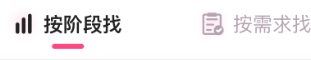
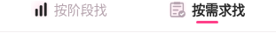
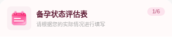
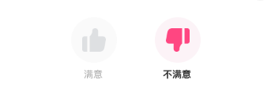

# 圈出组件实际渲染核对

项目标识：xiaonuan-ui-20261106-r2。以下为375×813浏览器渲染截图，不是微信真机截图。使用已上传的原素材，计分与交互规则保持不变。图片所在design-reference目录不打入小程序包。

## 咨询优势栏和人物组合

## 按阶段找

## 按需求找

## 隐私说明图标与报告装饰

## 提问标签原图

## 评估日历

## 问卷赞踩栏

## 不满意反馈原图

## 语音原图

## 原图仪表盘与动态箭头

## 星级与星星原图

